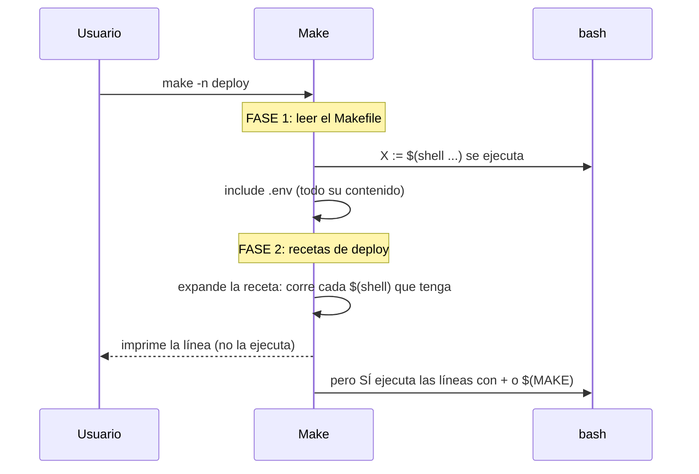

# Parse-time vs run-time, y qué hace `make -n`

La fase 1 ocurre siempre, también con `make help` y con `make -n`. En la fase 2, `-n` imprime las recetas en lugar de ejecutarlas, pero para imprimirlas tiene que expandirlas, y las líneas con `+` o `$(MAKE)` se ejecutan de todos modos. Lo que es shell dentro de la receta (`$$(cmd)`) es lo único que `-n` no toca.
