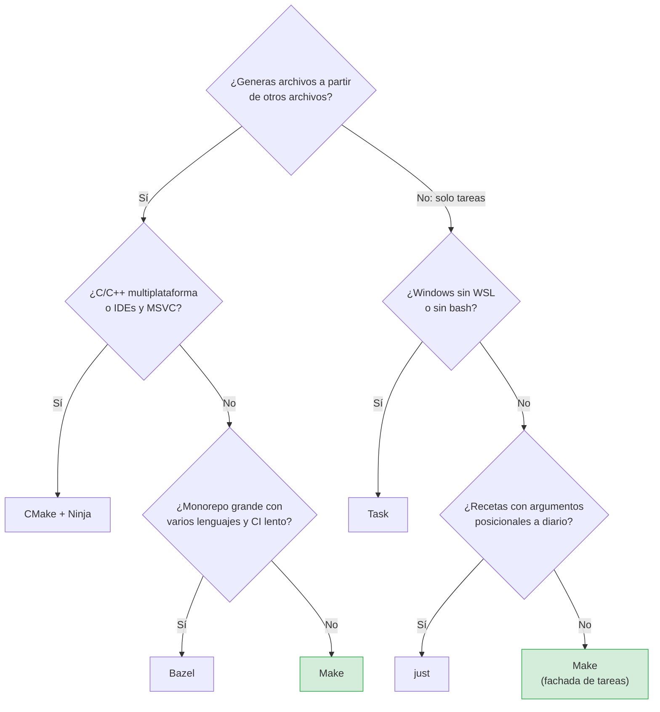

# ¿Make u otra herramienta?

La primera pregunta separa build systems de command runners: si no hay archivos que rehacer, el modelo de Make no aporta y just o Task pueden ser más cómodos. Si los hay, Make cubre la mayoría de casos; CMake y Bazel resuelven problemas de escala o de plataforma que tienen un coste de adopción real.
