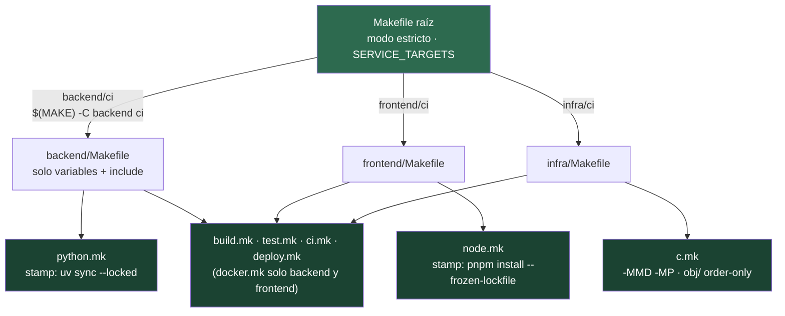

# Arquitectura de un Build System Multi-Lenguaje con Make

El Makefile raíz no sabe compilar Python, Node.js ni C: solo convierte cada `servicio/meta` en un nodo del grafo y delega con `$(MAKE)`, así que `-j3` comparte el jobserver y un fallo llega hasta arriba. Cada servicio importa `build.mk` primero (define `BUILD_DIR` y `STAMPS`), luego su módulo de lenguaje y después los genéricos. Las metas `lint` y `test` son comunes; lo que cambia por stack es `LINT_CMD`, `TEST_CMD` y el stamp de dependencias.
