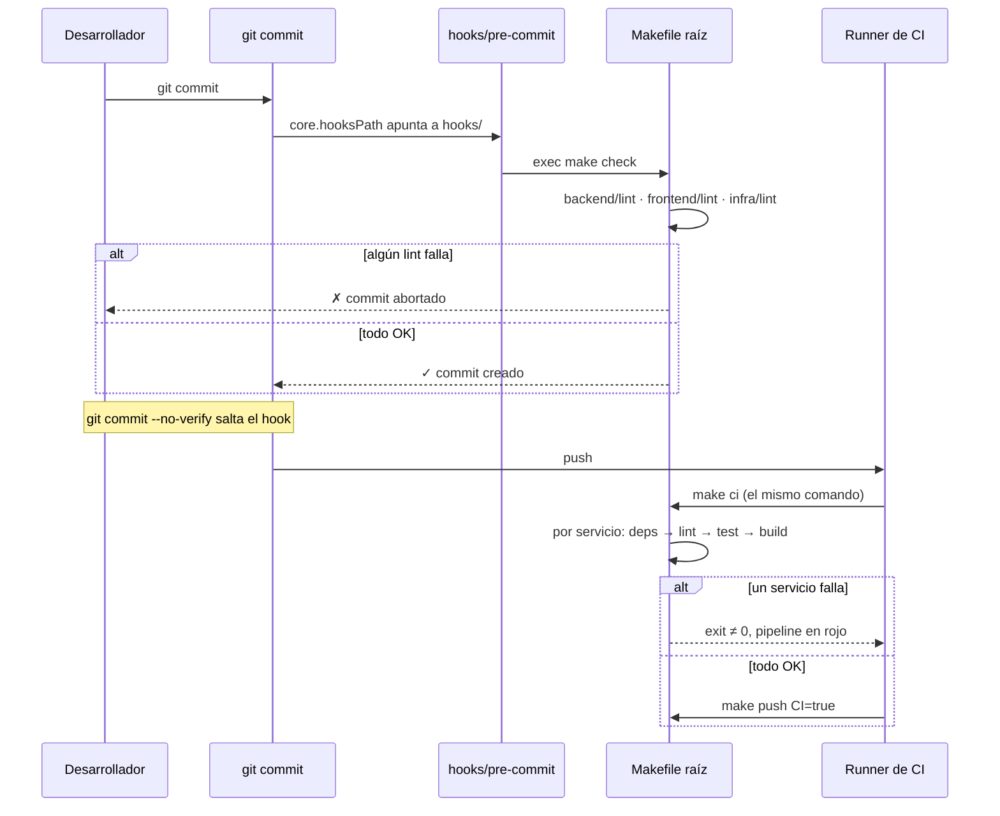

# Flujo del Pipeline: del commit a CI

El hook es rápido (solo lint) y es una ayuda: `--no-verify` lo salta. El control real es `make ci` en el runner, que ejecuta exactamente lo mismo que en tu máquina. `push` solo se intenta en CI, y su guarda `CI=true` evita accidentes; el acceso lo controlan las credenciales del registry, que solo tiene el runner.
