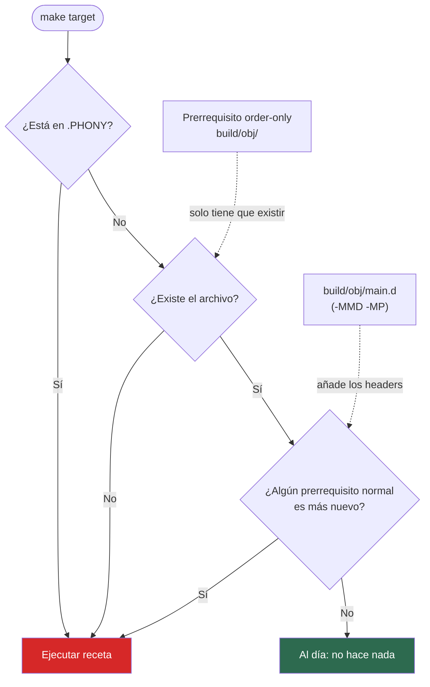

# Decisión de Make: ¿Qué reconstruir?

Make compara fechas: si el archivo existe y ningún prerrequisito normal es más nuevo, no hay trabajo. Los targets `.PHONY` siempre se ejecutan, por eso `deps` es un phony sin receta que depende de un stamp con fecha (`.stamps/deps: uv.lock`). Los directorios van como order-only porque su fecha cambia cada vez que se escribe dentro, y los `.d` de `-MMD -MP` añaden los headers a la comparación.
